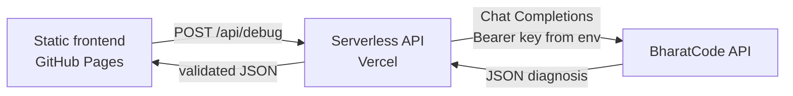

# Agent Autopsy

> **Find why your AI agent failed. Fix the prompt, tool call, or workflow.**

[](https://bharatcode.ai)
[](LICENSE)
[](https://bharatcode.ai)

**Live demo:**https://github.com/ArokiaNisha/agent-autopsy.git  **
**Backend API:** https://agent-autopsy-agbw3tt5o-arokianishaaldy-9310s-projects.vercel.app/*

Paste a failed agent run. Get the root cause, the exact step that broke, a rewritten prompt and a corrected tool call, ready to copy and re-run.

---

## The problem

AI agents rarely fail loudly. They fail because of:

- an ambiguous or incomplete system prompt
- the wrong tool being picked for the job
- a bad argument (for example `" ORD-10482 "` with stray spaces)
- invalid JSON in a tool call (trailing commas, single quotes, markdown fences)
- missing context or a badly formatted output

Developers then burn time reading prompts, model replies, tool outputs and stack traces by hand to work out what went wrong first.

## The solution

**Agent Autopsy** is a lightweight web app that turns a failed run into a structured diagnosis. You fill a guided form, a BharatCode model analyzes it, and you get:

| Field | What you get |
|---|---|
| Issue | A short, specific title |
| Failure type | `prompt`, `tool_call`, `json_format`, `missing_context`, `model_output` or `workflow` |
| Root cause | A clear explanation of why it failed |
| Problematic step | The exact field or step that failed first |
| Confidence | `high`, `medium` or `low` |
| Improved prompt | A complete rewritten prompt |
| Corrected tool call | Valid JSON you can paste and run (or `null`) |
| Next steps | Ordered actions, including how to verify the fix |

### What makes it different

This is not a generic "paste an error into a chatbot" tool. It is a **structured debugging workflow**:

1. A guided form captures the right evidence in the right fields.
2. The prompt forces *earliest-failure-first* reasoning, so a downstream tool error is traced back to the bad call or prompt that caused it.
3. The backend validates and normalizes a fixed JSON schema, so the UI is always consistent.
4. You get runnable artifacts (prompt and tool call), not just advice.

## Key features

- Guided form: objective, system prompt, model response, tool call, tool output, error, expected output, notes
- Three one-click realistic examples (whitespace in an argument, invalid JSON, wrong tool)
- Structured result panel with failure type and confidence badges
- **Before / After** comparison for prompt, tool call and error vs expected outcome
- Copy buttons for the improved prompt, the corrected tool call and the full diagnosis
- Save cases in the browser (`localStorage`) with **Open / Fixed** status and reopen support
- Download any diagnosis as a Markdown file
- Dark, responsive developer-tool UI with loading, error and empty states
- No login, no database, no API key in the browser

## Screenshots

| Home | Debugger form | Diagnosis |
|---|---|---|
|  |  |  |

| Before / After | Saved cases | Mobile |
|---|---|---|
|  |  |  |

*(Add your screenshots to `docs/screenshots/` using these file names.)*

## How it works

```
Browser (static site on GitHub Pages)
        |  POST /api/debug  (JSON)
        v
Serverless function (Vercel)  <-- BHARATCODE_API_KEY lives here only
        |  POST /v1/chat/completions
        v
BharatCode model API
        |  strict JSON diagnosis
        v
Validated + normalized JSON  -->  Result panel in the browser
```



1. The frontend sends the form fields to `/api/debug`.
2. The backend validates size and required fields, applies a small per-IP rate limit and builds a debugging prompt.
3. It calls the BharatCode API, extracts the JSON from the reply, validates the schema and normalizes the fields.
4. The frontend renders the report, the before/after view and the copy, save and download actions.

## BharatCode API usage

- Format: OpenAI-compatible **Chat Completions**
- Endpoint: `https://bharatcode.ai/api/model/v1/chat/completions`
- Header: `Authorization: Bearer <BHARATCODE_API_KEY>`
- Default model: `qwen-3.8-27b` (change it with `BHARATCODE_MODEL`)
- Low temperature (`0.2`) for consistent, structured output
- A dedicated system prompt (see [`api/debug.js`](api/debug.js)) makes the model act as a senior agent-debugging engineer and return **only** a JSON object

> Please verify the endpoint and model name against the official BharatCode documentation. Both can be changed with environment variables (`BHARATCODE_API_URL`, `BHARATCODE_MODEL`) without touching the code.

## Privacy and API key safety

- The API key is stored **only** as an environment variable on the backend.
- It is never in the browser, never in the repository and never in client-side code.
- `.env` files are git-ignored. Only `.env.example` (with a fake value) is committed.
- The backend keeps no database and stores no requests.
- Saved cases live only in your own browser's `localStorage`.
- Please do not paste real passwords, secrets or personal data into the form.
- The backend limits request size, rate-limits by IP and restricts CORS to your site via `ALLOWED_ORIGINS`.

## Project structure

```
agent-autopsy/
├── BharatCode.txt          # Build League project summary (must be in the root)
├── README.md
├── LICENSE
├── .gitignore
├── .env.example
├── package.json
├── vercel.json
├── index.html              # Frontend
├── styles.css
├── app.js
├── api/
│   └── debug.js            # Serverless backend (POST /api/debug)
├── examples/
│   ├── whitespace-tool-call.md
│   ├── invalid-json-tool-call.md
│   └── wrong-tool-selection.md
└── docs/
    ├── demo-script.md
    └── screenshots/
```

## Local setup

You need [Node.js 20+](https://nodejs.org) and a free [Vercel](https://vercel.com) account.

```bash
# 1. Get the code
git clone https://github.com/YOUR_GITHUB_USERNAME/agent-autopsy.git
cd agent-autopsy

# 2. Add your key for local testing (this file is git-ignored)
cp .env.example .env
# open .env and paste your real BHARATCODE_API_KEY

# 3. Run the site + API together
npx vercel dev
```

Open the URL it prints (usually http://localhost:3000). On localhost the frontend automatically calls `/api/debug` on the same server.

## Deploy the backend to Vercel

1. Go to [vercel.com](https://vercel.com) and sign up with GitHub.
2. Click **Add New... > Project** and import your `agent-autopsy` repository.
3. Leave **Framework Preset** as **Other**. Leave build settings empty.
4. Open **Environment Variables** and add:
   - `BHARATCODE_API_KEY` = your real key
   - `BHARATCODE_MODEL` = `qwen-3.8-27b`
   - `ALLOWED_ORIGINS` = `https://YOUR_GITHUB_USERNAME.github.io`
5. Click **Deploy**. Your backend URL looks like `https://agent-autopsy-xxxx.vercel.app`.
6. Open `app.js`, set `BACKEND_URL` to that URL, commit and push.

Vercel also serves the full site at that same URL, so you get a working fallback demo for free.

## Deploy the frontend to GitHub Pages

1. In your repository open **Settings > Pages**.
2. Under **Build and deployment**, set **Source** to **Deploy from a branch**.
3. Choose branch **main** and folder **/ (root)**, then click **Save**.
4. After about a minute your site is live at `https://YOUR_GITHUB_USERNAME.github.io/agent-autopsy/`.

To update the live site later, commit and push your changes to `main`. GitHub Pages redeploys automatically.

## Example use cases

| Case | Failure type | File |
|---|---|---|
| Stray whitespace in a tool argument makes a lookup return 404 | `tool_call` | [examples/whitespace-tool-call.md](examples/whitespace-tool-call.md) |
| Single quotes, trailing commas and a markdown fence break parsing | `json_format` | [examples/invalid-json-tool-call.md](examples/invalid-json-tool-call.md) |
| A finance question is sent to web search instead of the database | `prompt` | [examples/wrong-tool-selection.md](examples/wrong-tool-selection.md) |

## Roadmap

- [ ] Paste a full multi-step trace and auto-detect the failing step
- [ ] Support common agent framework trace formats
- [ ] Generate a regression test for every fixed case
- [ ] Shareable diagnosis links and team case libraries
- [ ] CLI and VS Code extension
- [ ] Failure pattern analytics across saved cases
- [ ] Explanations in Hindi and other Indian languages

## License

[MIT](LICENSE) © 2026 [YOUR_NAME]

---

**Built for the BharatCode Build League.** · **Powered by BharatCode.**
